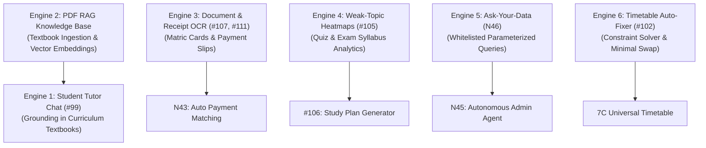

### Phase 13 (FINAL): AI Engine Improvements & Autonomous Automation (19 Services — Lite, Plus & Full Tiers)

> [!IMPORTANT]
> **Registry Outcome:** 136 + 19 = **155 live + 6 roadmap = 161 Total** (The 6 remaining roadmap features are #79 Biometrics, #82 Payment Gateway, #84 SMS, #85 WhatsApp, N12 Custom Domains, and N14 SSO).
> **Core Architectural Pillars for Academix AI:**
> 1. **Zero Tenant Credential Management:** All LLM inference calls execute via Super Admin master platform keys (`GEMINI_API_KEY`). Individual colleges never provision or manage third-party AI credentials.
> 2. **Centralized Ledger & Dual-Bucket Debiting:** Every model invocation evaluates token consumption and atomically debits `AICreditLedgerEntry` (`PLAN` monthly allowance first, non-expiring `PURCHASED` credits second).
> 3. **Config-Driven Model Registry & Token Ratios (`backend/config/aiConfig.js`):**
>    - Model identifiers, endpoints, and token multipliers live strictly in configuration, not in application code:
>      * Lite Models (`process.env.AI_LITE_MODEL || 'gemini-1.5-flash'`): 1 Token = 1 Credit.
>      * Advanced Models (`process.env.AI_ADVANCED_MODEL || 'gemini-1.5-pro'`): 1 Token = 20 Credits.
> 4. **Active Cost Instrumentation (`TokenCostSample`):** Real-time monitoring logs model costs to validate economic assumptions before final tier adjustments:
>    ```prisma
>    model TokenCostSample {
>      id           String   @id @default(uuid())
>      college_id   String
>      featureKey   String   // 'ai-tutor-chat', 'document-ocr', 'ask-your-data'
>      modelName    String   // 'gemini-2.5-flash-lite', 'gemini-2.5-pro'
>      promptTokens Int
>      outputTokens Int
>      creditsDebited Int
>      latencyMs    Int
>      createdAt    DateTime @default(now())
>
>      @@index([featureKey, createdAt(sort: Desc)])
>    }
>    ```
> 5. **Autonomous Agent Safety Boundary (N45):** The Autonomous AI Admin Agent creates **action drafts** with human-in-the-loop 1-click execution. It never mutates financial balances or attendance records without explicit staff confirmation.

---

#### 13A: The 6 Specialized Academic AI Engines



##### 1. Engine 1: Student Tutor Chat (#99 — StartsIn: Premium @ 10 msgs/day, Enterprise @ 30 msgs/day)
* **Institutional Job:** 24/7 safe academic AI tutor grounded strictly in intermediate curriculum textbooks, answering student queries, explaining derivations, and generating practice problems.
* **Grounding & Safety Rules:**
  - Queries are embedded and matched against Engine 2 (PDF Knowledge Base). Prompts are augmented with retrieved textbook excerpts and page citations.
  - Strict system prompt prevents out-of-curriculum hallucination, political/sensitive discussions, and homework direct solutions without step-by-step guidance.
  - Per-student daily message caps enforced by `tutorChat:${studentId}` daily counter.

##### 2. Engine 2: PDF Knowledge Base & RAG Indexer (#100 — StartsIn: Premium)
* **Institutional Job:** Ingestion, text extraction, semantic chunking, and embedding generation for official intermediate textbooks (Punjab Textbook Board, Sindh Textbook Board, National Book Foundation).
* **Data Models:**
  ```prisma
  model KnowledgeBook {
    id          String   @id @default(uuid())
    college_id  String?  // The single multitenancy exception: NULL = platform shared textbook; Non-null = college custom notes
    subject_id  String
    class       String   // "FSc Part 1"
    title       String   // "Physics Part 1 - Punjab Curriculum"
    fileKey     String   // Stored in R2 (server-exempt)
    status      String   @default("INDEXED") // PENDING | INDEXING | INDEXED | FAILED
    totalChunks Int      @default(0)
    createdAt   DateTime @default(now())

    // All RAG queries strictly enforce: WHERE (college_id = :collegeId OR college_id IS NULL)
    chunks      DocumentChunkVector[]
    @@index([subject_id, class])
  }

  model DocumentChunkVector {
    id          String   @id @default(uuid())
    bookId      String
    chunkIndex  Int
    chapterName String?
    pageNumber  Int
    chunkText   String
    embedding   Unsupported("vector(768)") // pgvector 768-dim embeddings

    book        KnowledgeBook @relation(fields: [bookId], references: [id], onDelete: Cascade)
    @@index([bookId, pageNumber])
  }
  ```
* **Retrieval Protocol:**
  - Uses cosine distance (`<=>` operator in PostgreSQL pgvector) to retrieve top-3 most relevant chunks:
    ```sql
    SELECT "chunkText", "pageNumber", "chapterName"
    FROM "DocumentChunkVector"
    WHERE "bookId" = $bookId
    ORDER BY embedding <=> $queryVector
    LIMIT 3;
    ```

##### 3. Engine 3: Vision OCR & Receipt Processing (#107, #111, N43 — StartsIn: Premium)
* **Institutional Job:** Multimodal document extraction reading text from Matriculation result cards, B-Form certificates, and payment screenshots/slips.
* **Extraction Schemas:**
  - `#107 Matric OCR`: Extracts `{ rollNumber, boardName, passingYear, totalMarks, obtainedMarks, studentName, fatherName }`.
  - `#111 Payment Slip OCR`: Extracts `{ transactionId, senderPhone, amountPkr, paymentDate, channel }`.
  - `N43 Payment Reconciliation`: Automatically queries open `Fee` records for the student; if `amountPkr` matches open balance and `transactionId` is verified, marks fee paid and generates verified receipt.

##### 4. Engine 4: Weak-Topic Diagnostic Heatmaps (#105 — StartsIn: Premium)
* **Institutional Job:** Analyzes classroom test results and online quiz attempts mapped to `SyllabusUnit` topics to generate visual color-coded mastery heatmaps (Green: >75%, Yellow: 50-75%, Red: <50%).
* **Output:** Surfaces class-wide and student-level concept gaps for targeted revision.

##### 5. Engine 5: Ask-Your-Data Conversational Analytics (N46 — StartsIn: Premium @ 50 queries/mo, Enterprise: Unlimited)
* **Institutional Job:** Natural language reporting allowing principals to ask questions like *"Show me students with less than 75% attendance who have not paid October fees"* and receive instant tables.
* **Security & SQL Injection Prevention:**
  - **Raw LLM-generated SQL execution is strictly blocked.**
  - Natural language query maps to a catalog of 40+ parameterized Prisma query templates (`backend/services/analyticsTemplates.js`).
  - LLM extracts parameters (date range, section, minimum attendance percentage) and passes them into verified type-safe Prisma queries.

##### 6. Engine 6: Timetable Conflict Explainer & Auto-Fixer (#102 — StartsIn: Enterprise)
* **Institutional Job:** Constraint satisfaction engine identifying root causes of timetable scheduling deadlocks (e.g. Teacher A unavailable on Fridays, Lab 1 overbooked) and proposing minimal-swap resolutions directly applicable to Phase 7C draft profiles.

---

#### 13B: Tiered Service Progression Matrix

| Service | Feature Key | StartsIn | Monthly Limit | Capabilities |
|:---|:---|:---|:---|:---|
| **#101 AI Assessment Generator** | `ai-quiz-generator` | Standard | 20 / mo (Std), 150 / mo (Prem), $\infty$ (Ent) | Generates MCQs and short questions aligned with board syllabus |
| **#109 Notice Translation** | `ai-notice-translation` | Standard | 30 / mo (Std), 300 / mo (Prem), $\infty$ (Ent) | Urdu Nastaleeq & English reciprocal translation and tone styling |
| **#99 Student Tutor Chat** | `ai-tutor-chat` | Premium | 10 msgs/day (Prem), 30 msgs/day (Ent) | Interactive curriculum tutor grounded via Engine 2 |
| **#100 Knowledge Library** | `ai-knowledge-library`| Premium | Included | Official board textbook repository & RAG indexer |
| **#103 Pedagogy Generator** | `ai-pedagogy-generator`| Premium | 100 / mo (Prem), $\infty$ (Ent) | Lesson pacing guides, laboratory rubrics, lecture notes |
| **#104 Board Syllabus MCQs** | `ai-board-mcqs` | Premium | Within #101 cap | Strict alignment with BISE exam question patterns |
| **#105 Weak-Topic Detection** | `ai-weak-topics` | Premium | Included | Class concept mastery diagnostic heatmaps |
| **#107 Document OCR** | `ai-document-ocr` | Premium | 150 / mo (Prem), $\infty$ (Ent) | Matric result card extraction |
| **#111 Screenshot OCR** | `ai-payment-ocr` | Premium | Included | Bank slip & mobile wallet screenshot data extraction |
| **N43 Auto Payment Match** | `ai-payment-matching`| Premium | Included | Automatic matching of OCR slips to pending fee vouchers |
| **N44 Read-Only AI Assistant** | `ai-readonly-assistant`| Premium | Included | Staff query assistant without write capabilities |
| **N46 Ask-Your-Data** | `ai-ask-your-data` | Premium | 50 / mo (Prem), $\infty$ (Ent) | Whitelisted parameterized natural language analytics |
| **N47 Report Remarks** | `ai-report-remarks` | Premium | Included | Generates personalized progress remarks for report cards |
| **N45 Autonomous Admin Agent** | `ai-autonomous-agent` | Enterprise | Included | Proactive action drafts with 1-click administrative execution |
| **`ai-daily-quiz` Daily Quiz**| `ai-daily-quiz` | Enterprise | Included | Daily 5-question review quizzes based on daily lesson progress |
| **#102 Timetable Auto-Fixer** | `ai-timetable-fixer` | Enterprise | Included | Explains schedule clashes and executes minimal swaps |
| **#106 Study Plan Suggestions**| `ai-study-plans` | Enterprise | Included | Generates student-specific exam revision calendars |
| **#108 WhatsApp Admissions Bot**| `ai-whatsapp-bot` | Enterprise | Included | Automated applicant Q&A answering prospectus queries |
| **#110 At-Risk Student Alerts**| `ai-at-risk-alerts` | Enterprise | Included | Predictive early detection of students at risk of board failure |
| **N42 Staff Appraisal Assistant**| `ai-staff-appraisal` | Enterprise | Included | Compiles evaluation surveys into staff appraisal briefs |
| **N48 Outreach Anomaly Drafts**| `ai-outreach-drafts`| Enterprise | Included | Proactive communication drafts for fee defaulters |
| **N49 Audio Lecture Summarizer**| `ai-lecture-transcribe`| Enterprise | Included | Summarizes recorded classroom lectures into study notes |
| **N50 Answer Marking Assistant**| `ai-answer-marking` | Enterprise | Included | Evaluates student exam answers against teacher rubrics |
| **N51 Admission Lead Scoring** | `ai-lead-scoring` | Enterprise | Included | Predicts admission conversion probability for prospective leads |

---

#### 13C: Autonomous AI Admin Agent (N45 — Enterprise Tier)

* **Institutional Job:** Proactive autonomous assistant scanning institutional state daily and preparing pending action cards in Super Admin and College Admin dashboards.
* **Proactive Routine Scenarios:**
  1. *Fee Reminders:* Detects unpaid vouchers 3 days prior to due date; prepares draft circular announcement with list of affected parents.
  2. *Teacher Absence Substitutions:* Detects approved morning teacher leave; cross-references Universal Timetable (#78) and proposes replacement teachers with free periods.
  3. *Attendance Irregularity Notice:* Detects 3 consecutive student unexcused absences; prepares parent summon draft.
* **Safety Architecture:**
  - Stored as `PendingAgentAction(id, college_id, actionType, payloadJson, status = 'PENDING_APPROVAL')`.
  - Admin clicks **"Approve & Execute"** or **"Dismiss"** in the dashboard. No action executes autonomously without human confirmation.

---

#### Phase 13 Contract Tests (`backend/tests/phase13_contract.test.js`)

| Test | Covers |
|:---|:---|
| AI credit ledger correctly debits PLAN bucket first, then PURCHASED bucket | Ledger Service |
| 1 credit per Lite token; 20 credits per Advanced token accurately applied | Multipliers |
| Insufficient AI credits returns HTTP 422 `INSUFFICIENT_AI_CREDITS` | Quota Gate |
| Student tutor chat blocked after 10 daily messages on Premium; elevated to 30 on Enterprise | #99 |
| PDF RAG retrieval fetches top-3 cosine distance chunks matching query | Engine 2 |
| Payment screenshot OCR extracts transaction ID and matches open voucher | #111 / N43 |
| Ask-Your-Data rejects arbitrary raw SQL and safely routes through Prisma templates | N46 |
| Autonomous Admin Agent creates pending action draft; requires 1-click execution | N45 |
| `TokenCostSample` accurately records token usage and latency for every LLM call | Instrumentation |

